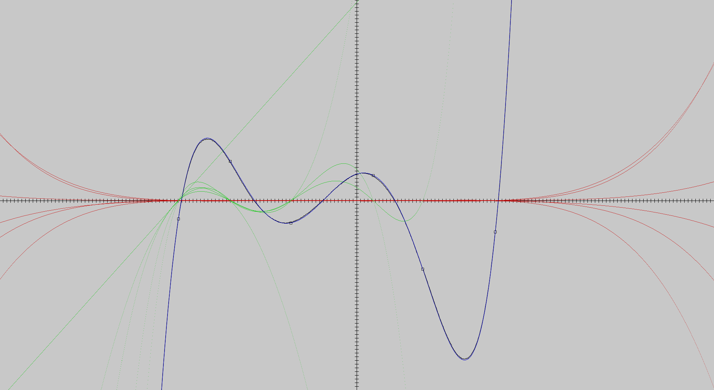

# Polynomial interpolation demo

A simple GUI program, to demonstrate polynomial interpolation. 

# Usage
Run the program using [processing](processing.org). Then click six times to create points. The algorithm will generate a polynomial through all six points.

# Screenshot

This screenshot shows an example of a polynomial and its factors generated by the interpolation algorithm.
